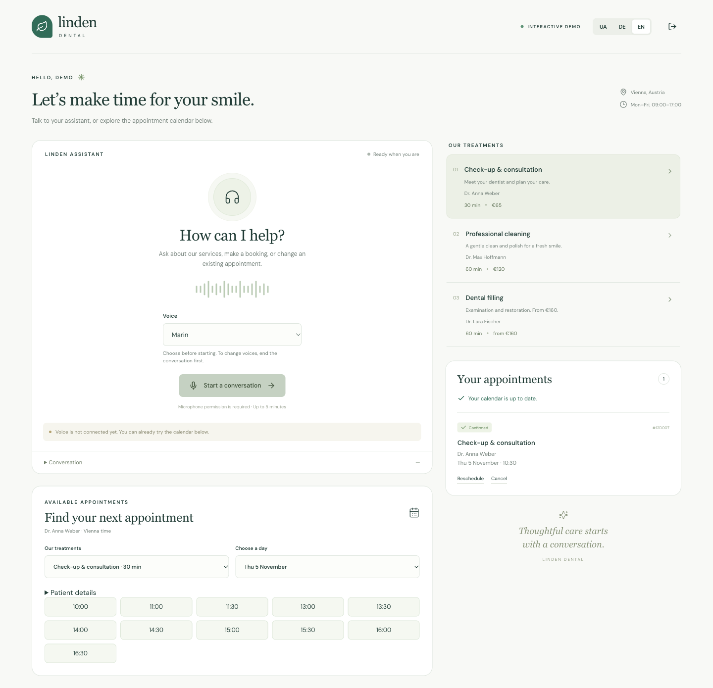
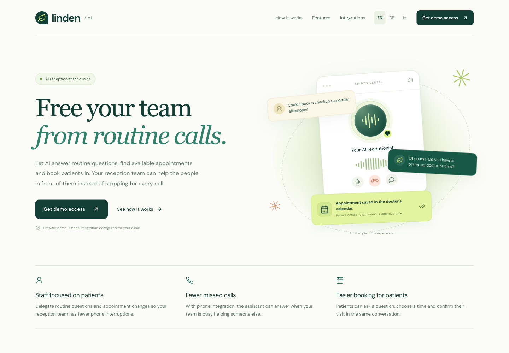

# Linden AI

**An open-source foundation for AI receptionists and conversational booking.**

The core is the focus of this project: helping assistants turn conversations into confirmed actions. The clinic demo shows it in use; future development will expand the core and its integrations.

[Setup & configuration](docs/configuration.md) · [Architecture](docs/architecture.md) · [MIT license](LICENSE)

## Core

Shared capabilities for voice conversations, availability checks, booking, rescheduling and cancellation—with explicit confirmation before changes. Google Calendar synchronization and email delivery are already supported.

The core currently ships together with the clinic demo. Making it independently reusable is part of the roadmap.

## Clinic demo

A fictional dental clinic demonstrates the booking flow in **English, German and Ukrainian**, through voice and calendar controls.

View the demo landing page

*Screenshots use synthetic data. Voice and Google Calendar are disconnected in these local previews.*

## Roadmap

- Separate the reusable core from clinic-specific rules and presentation.
- Add integrations for more calendars, CRM and business software.
- Extend conversations to phone and WhatsApp, and support more business scenarios.

These are planned directions; phone, WhatsApp and CRM connectors are not included yet. Contributions to the core and integrations are welcome—see the [development guide](docs/configuration.md#contributing).

## License

[MIT](LICENSE). Third-party assets retain their own rights; see [notices](THIRD_PARTY_NOTICES.md).
